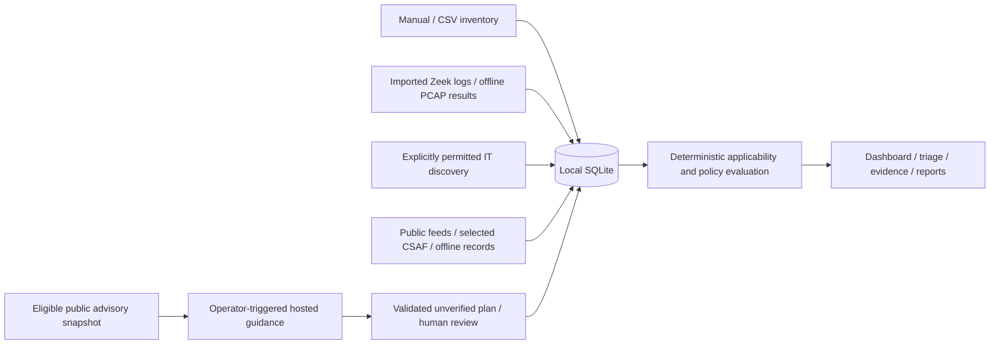

# Architecture and security boundaries

[Documentation index](README.md)

## Modular monolith

Phylax uses Python's standard library, a local SQLite database, a loopback HTTP server, and server-rendered HTML/SVG. It has no frontend build step or application package dependencies.

| Modules | Responsibility |
|---|---|
| `core`, `migrations`, `validation` | Persistence, additive upgrades, validated inputs, audit |
| `asset_intelligence`, `observations` | Context, approvals, observed identity, software and change evidence |
| `adapters`, `feeds`, `csaf` | Normalized intelligence, source health, snapshots and checkpoints |
| `correlation`, `prioritization` | Conservative component/inventory matching and transparent urgency |
| `monitoring`, `pcap`, `watcher` | Passive parsing, policy evaluation, offline tool orchestration and finalized-log ingestion |
| `discovery` | Permission-bound queue, execution, schedules, lease and recovery |
| `surface`, `topology` | Evidence-derived relationships, bounded graph, contextual investigation |
| `triage`, `reports` | Alert lifecycle, acknowledgement, evidence and exports |
| `ai`, `remediation`, `remediation_lifecycle` | Public-data guidance and manual plan lifecycle |
| `web`, `release_web`, `*_views`, `theme`, `ui`, `web_security` | Routes, shared presentation and request protections |

## Persistence and execution

SQLite stores source records and provenance, inventory, observations, findings, policy versions, alerts, software assessments, approvals, process relationships, scan queues/runs, watcher checkpoints, plans/history, and audit events. Identifiers survive additive upgrades. Timestamps are UTC. One database assumes non-overlapping IP spaces; use separate databases for overlapping networks.

Each process/thread owns its connection. Imports use bounded input handling and transactions/savepoints. Scanner execution has a database-backed lease and persistent history. NVD page checkpoints and watcher hashes survive restart. Dashboard feed/guidance job progress is process-local: queued UI jobs do not survive restart. These mechanisms have different recovery guarantees.

## Trust model

Local operators and the filesystem holding database/configuration are trusted. Imported CSV, JSON, logs, captures, advisory text, provider output, and device metadata are untrusted inputs.

- Host/Origin checks and form tokens protect mutations; output is escaped and responses include CSP, frame restrictions, no-store, and nosniff.
- Opaque or cross-origin requests remain rejected. The dashboard is localhost-only, without multi-user authentication or enterprise role enforcement.
- Tools use fixed executables, argument arrays, safe temporary directories, resource/input bounds, and timeouts. Advisory text never becomes executable commands.
- Network access occurs for configured feeds, optional hosted generation, explicitly approved IT probes, and the separately managed lab/sensor. Passive imports send no device probes.
- Scan permission, management approval, acknowledgement, and inventory verification cannot substitute for one another.
- Reports contain sensitive local context. Database and export access depend on local filesystem controls; Phylax does not provide encryption-at-rest or an immutable forensic audit service.

## AI guidance and human review

AI is optional and invoked only by an operator. Only trusted public-feed advisory snapshots pass the outbound public-field allowlist. Local asset identifiers, inventory, network events, policies, and risk/process context remain on the host. Uploaded records cannot confer trusted hosted eligibility or overwrite the trusted outbound snapshot; synthetic fixtures never call the model.

Citation URLs must come from supplied references. Response shape and common executable-command syntax are checked. These checks do **not** establish factual correctness or semantic support. UI labels remain AI-generated and unverified. Requested/returned model, generation time, supplied references, cited subset, and archived plans retain provenance. Missing vendor guidance stays explicit. Provider failures preserve an existing hosted plan; changed evidence during generation requires retry.

The manual lifecycle includes recommendation, review, approval, deferral/rejection, externally performed implementation, and recorded verification. Approval requires a named reviewer; verification requires evidence. Regeneration or changed supporting evidence invalidates prior review. A manual lifecycle status records an operator assertion, not an infrastructure action performed by Phylax.

AI cannot change applicability, severity, priority, acknowledgement, device approval, or scan permission. AI policy configuration, RAG, and autonomous remediation are not implemented.

## Coverage and limitations

- Passive visibility is limited to imported evidence and the external collector's observation point. Silence does not prove absence/removal.
- Modbus policy detection is supported when decoded fields exist; there is no claim of complete OT-protocol coverage. Separate ICSNPP installation/certification is outside the runner.
- Version matching covers exact identities/versions and supported numeric bounds. Unsupported prerequisites, product relationships, and version semantics require review.
- CSAF support is narrow, selected-document ingestion; no complete archive or detached-signature verification.
- No CVSS/probability, device model, or exploit status is invented. KEV and high CVSS do not prove a local attack.
- No automated patching, isolation, controller commands, or firewall modifications.
- No production TNI deployment, formal compliance certification, overlapping network namespaces, credentialed inventory, or cloud connectors are claimed.
- Performance depends on dataset and machine. Small lab measurements are not throughput guarantees; record hardware, versions, dataset size, runtime, and limitations for each rehearsal.
