# Phylax workflow atlas

These diagrams describe implemented operator paths, decisions and recovery behavior; they are not a claim that every arbitrary input or deployment scenario is covered.

[Open the offline interactive atlas](index.html). Generated SVG and DOT files are under `diagrams/`. No inventory, database or API secrets are read by this generator.

## Workflow index

1. [End-to-end system](#overview)
2. [Setup, access and configuration](#setup)
3. [Inventory and operational context](#inventory)
4. [Passive collection and ingestion](#passive)
5. [Identity, management and change review](#management)
6. [Approved active IT discovery](#discovery)
7. [Intelligence sync, resume and offline load](#intelligence)
8. [Software, applicability and reassessment](#correlation)
9. [Policy detection, urgency and Triage](#triage)
10. [Topology investigation](#topology)
11. [Guidance generation and public-data boundary](#guidance)
12. [Complete remediation lifecycle](#lifecycle)
13. [Reporting, offline operation and recovery](#operations)
14. [Complete controlled demonstration](#demo)

## End-to-end system

How all operator workflows join local evidence, decisions and review.

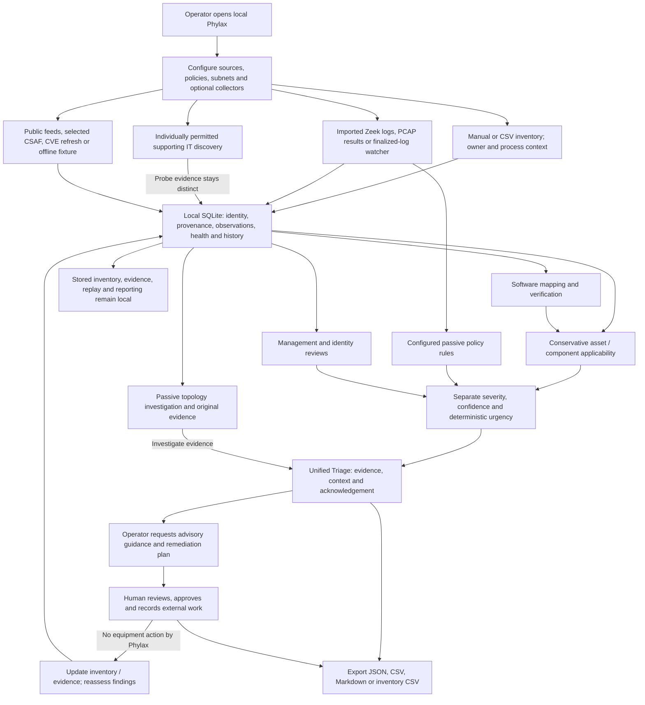

[Open SVG](diagrams/overview.svg) · [Editable Graphviz source](diagrams/overview.dot)

- Inventory verification, management approval, scan permission, acknowledgement and plan approval are independent decisions.
- All local asset, network, policy and process context stays on the host. Only eligible public advisory fields can go to an operator-requested hosted model.
- An observation or vulnerability match does not prove compromise. Missing observations or findings do not prove safety.

**Implementation:** [phylax/web.py](../../phylax/web.py), [phylax/release_web.py](../../phylax/release_web.py), [phylax/core.py](../../phylax/core.py), [phylax/topology.py](../../phylax/topology.py).

## Setup, access and configuration

Local startup, optional tools, safe editing and separate execution processes.

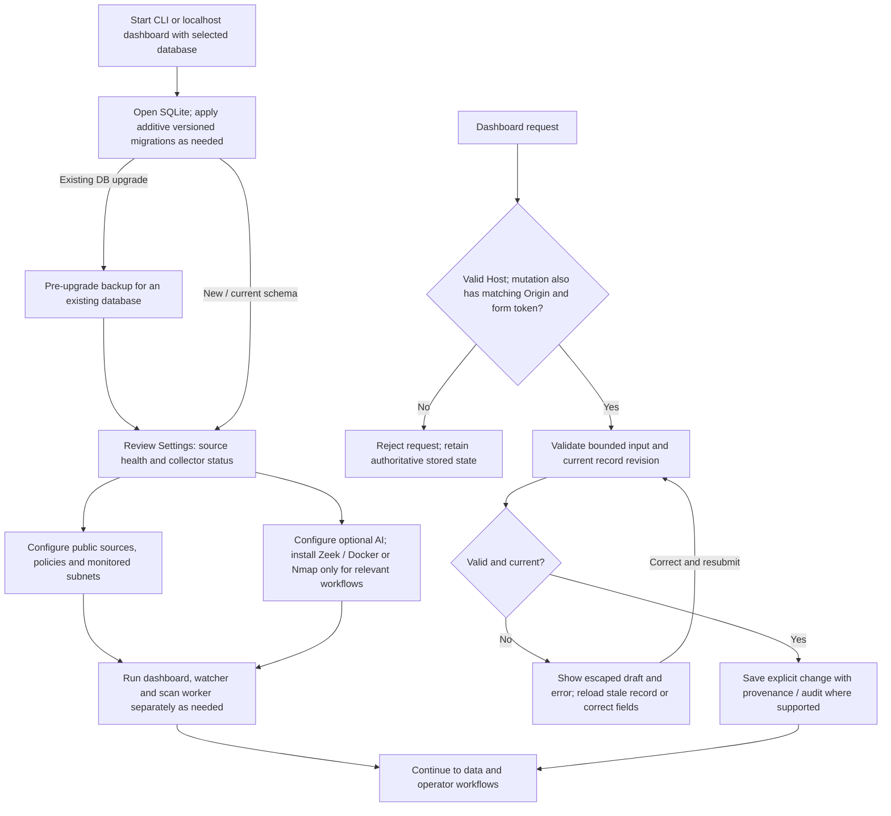

[Open SVG](diagrams/setup.svg) · [Editable Graphviz source](diagrams/setup.dot)

- The dashboard remains localhost-only. Typed operator names provide attribution, not multi-user authentication.
- Viewing settings does not probe connectivity. No page visit automatically scans devices or requests hosted guidance.
- Each process owns its SQLite connection. Current web forms should be reloaded after server restart.

**Implementation:** [phylax/migrations.py](../../phylax/migrations.py), [phylax/web_security.py](../../phylax/web_security.py), [phylax/web.py](../../phylax/web.py), [phylax/operator_pages.py](../../phylax/operator_pages.py).

## Inventory and operational context

Import, validate, reconcile and maintain evidence without guessing identities.

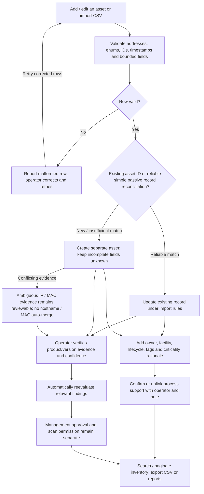

[Open SVG](diagrams/inventory.svg) · [Editable Graphviz source](diagrams/inventory.dot)

- A manufacturer name or IP address alone never establishes an exact model or firmware version.
- Valid CSV rows can be imported while malformed rows are reported. Re-importing a stable asset ID updates that record.
- Observed metadata remains distinct from manual verification. Process links explain support; they do not silently change criticality.

**Implementation:** [phylax/core.py](../../phylax/core.py), [phylax/validation.py](../../phylax/validation.py), [phylax/asset_intelligence.py](../../phylax/asset_intelligence.py), [phylax/configuration_pages.py](../../phylax/configuration_pages.py).

## Passive collection and ingestion

Three entry paths converge on validated, provenance-preserving local observations.

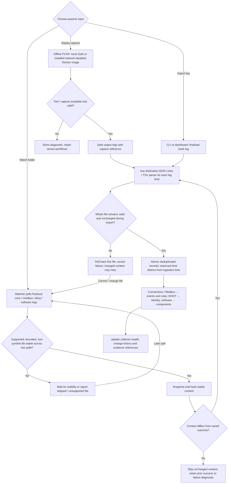

[Open SVG](diagrams/passive.svg) · [Editable Graphviz source](diagrams/passive.dot)

- Zeek collection is externally managed. Phylax observes only captured or imported evidence; it does not discover every silent device.
- Current supported log kinds are conn, modbus, dhcp and software. A conn service label alone does not identify a Modbus write.
- Collector inactivity and device inactivity are different. Neither silence nor a missing protocol field proves removal or malicious traffic.

**Implementation:** [phylax/pcap.py](../../phylax/pcap.py), [phylax/monitoring.py](../../phylax/monitoring.py), [phylax/observations.py](../../phylax/observations.py), [phylax/watcher.py](../../phylax/watcher.py).

## Identity, management and change review

Approve, block or review endpoints only within explicit monitoring scope.

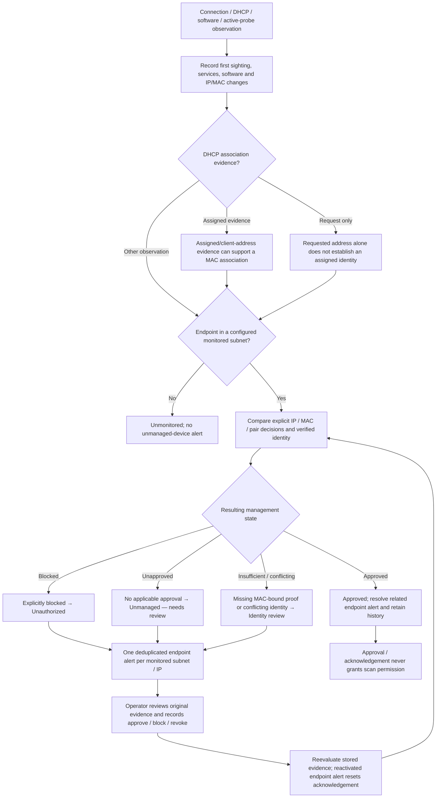

[Open SVG](diagrams/management.svg) · [Editable Graphviz source](diagrams/management.dot)

- Existing inventory is not automatically management-approved. The system uses Unauthorized only for an applicable explicit block.
- Observation and ingestion timestamps stay separate. Neither hostname nor MAC similarity automatically merges inventory records.
- Inspect the Changes and Approvals tools under Assets; a resolution keeps management history.

**Implementation:** [phylax/asset_intelligence.py](../../phylax/asset_intelligence.py), [phylax/observations.py](../../phylax/observations.py), [phylax/review_pages.py](../../phylax/review_pages.py).

## Approved active IT discovery

A persistent queue and separate worker enforce per-target permission and bounded probing.

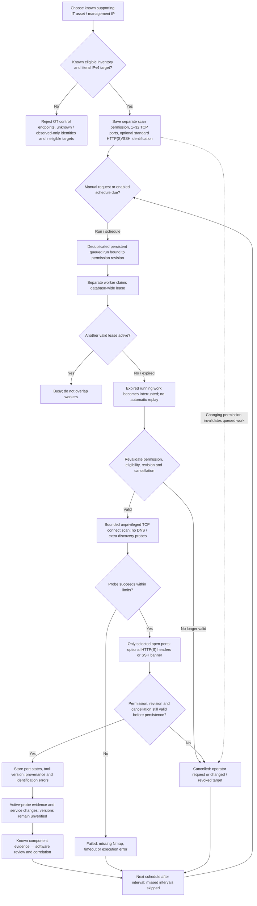

[Open SVG](diagrams/discovery.svg) · [Editable Graphviz source](diagrams/discovery.dot)

- At most one active run per database; 30-second scan timeout, 180-second execution bound, and constrained pacing. No CIDR expansion, scripts, UDP or OS fingerprinting.
- Identification is limited to SSH 22, HTTP 80/8080 and HTTPS 443/8443. Redirects/authentication are disabled; TLS failures remain explicit.
- No response is not proof a device is offline. Results never auto-expand permissions or scan OT endpoints.

**Implementation:** [phylax/discovery.py](../../phylax/discovery.py), [phylax/release_cli.py](../../phylax/release_cli.py), [phylax/configuration_pages.py](../../phylax/configuration_pages.py).

## Intelligence sync, resume and offline load

Public collection remains independent of inventory; failures retain cached records.

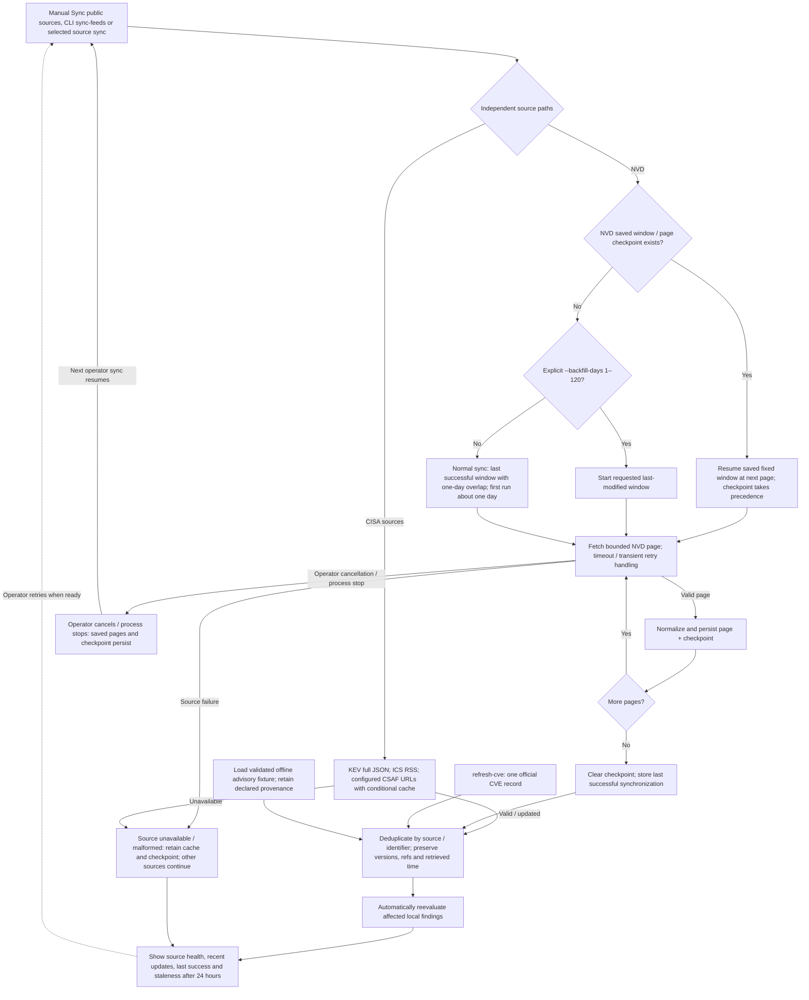

[Open SVG](diagrams/intelligence.svg) · [Editable Graphviz source](diagrams/intelligence.dot)

- No asset inventory is sent to feed services. A backfill is a wider last-modified window, not a complete historical download.
- KEV supplies exploitation-catalog metadata, not affected-version ranges or proof of attack. RSS-only advisories remain review references without invented version conditions.
- Configured CSAF is a narrow official-URL adapter. Unsupported status relationships / version expressions remain for review; advisories without CVEs are retained.

**Implementation:** [phylax/feeds.py](../../phylax/feeds.py), [phylax/adapters.py](../../phylax/adapters.py), [phylax/csaf.py](../../phylax/csaf.py), [phylax/core.py](../../phylax/core.py).

## Software, applicability and reassessment

Exact product evidence and supported version semantics drive findings; similarity is not proof.

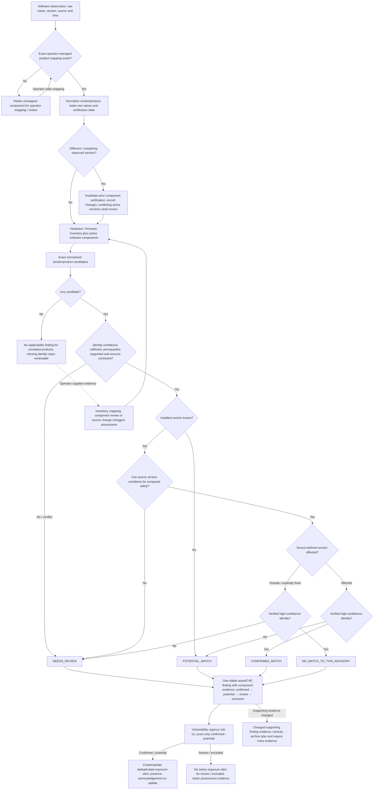

[Open SVG](diagrams/correlation.svg) · [Editable Graphviz source](diagrams/correlation.dot)

- Actual assessment ordering also checks low confidence, unsupported version semantics and conflicting source conditions. Incomplete evidence cannot produce a fabricated confirmed match.
- Vulnerability v2: KEV +3; severity critical/high/medium +3/+2/+1; asset criticality +3/+2/+1; confirmed applicability +2; known DMZ +1. Urgency: critical ≥8, high 6–7, medium 3–5, low 0–2.
- Unknown severity adds no invented CVSS. Vendor fix and observed reachability are not inferred. Removing an obsolete product association archives its plan before removing the finding.

**Implementation:** [phylax/correlation.py](../../phylax/correlation.py), [phylax/observations.py](../../phylax/observations.py), [phylax/prioritization.py](../../phylax/prioritization.py), [phylax/core.py](../../phylax/core.py).

## Policy detection, urgency and Triage

Passive rules, management reviews and exposures converge on human investigation.

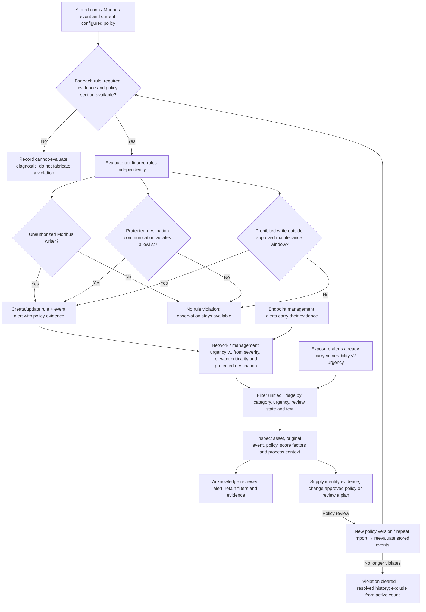

[Open SVG](diagrams/triage.svg) · [Editable Graphviz source](diagrams/triage.dot)

- Normal reads, authorized writes and new peers are not automatically malicious. Missing fields and unconfigured policy sections remain explicit.
- Network v1 adds severity 0–3, relevant asset criticality 0–3 and protected destination +1. Urgency: critical ≥6, high 4–5, medium 2–3, low 0–1.
- Acknowledgement does not fix a vulnerability, approve a device, grant permission or execute remediation. Severity, applicability, urgency and confidence stay separate.

**Implementation:** [phylax/monitoring.py](../../phylax/monitoring.py), [phylax/triage.py](../../phylax/triage.py), [phylax/triage_views.py](../../phylax/triage_views.py), [phylax/prioritization.py](../../phylax/prioritization.py).

## Topology investigation

Move from a bounded passive map to actual identity, communications and finding evidence.

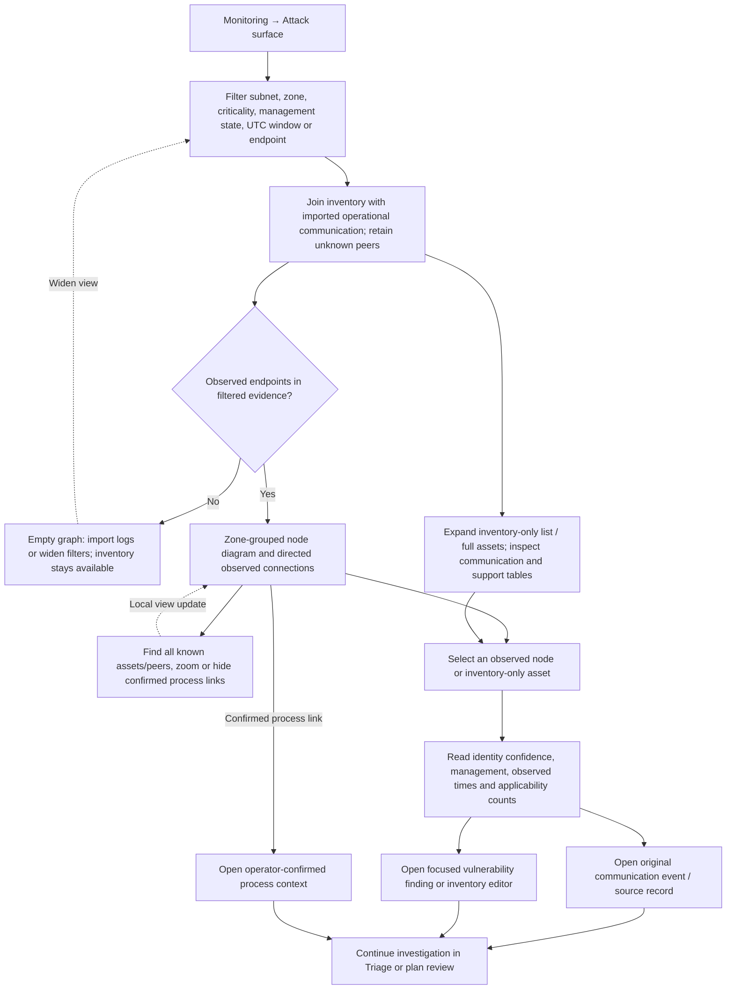

[Open SVG](diagrams/topology.svg) · [Editable Graphviz source](diagrams/topology.dot)

- The diagram is bounded to 24 observed endpoints, 60 directed connections and 12 process nodes. Omission counts are visible; evidence remains in the tables.
- Colliding port/protocol labels are suppressed with an explicit count, not lost. Inspectable edge metadata and original event links remain.
- Find includes inventory-only and older peers; zero results leave no unrelated selection. Mobile details precede the natural-size scrollable graph.
- Observation existence is independent of the 1,000-group listing cap. Asset/focus filters precede that cap; event totals are time-scoped before asset filters.
- Zone grouping is inventory context, not a trust boundary. Dashed process support is an operator assertion, not an inferred network or attack path.

**Implementation:** [phylax/topology.py](../../phylax/topology.py), [phylax/surface.py](../../phylax/surface.py), [phylax/web.py](../../phylax/web.py), [phylax/release_web.py](../../phylax/release_web.py).

## Guidance generation and public-data boundary

Only an operator request may call a hosted model, and only with trusted public advisory fields.

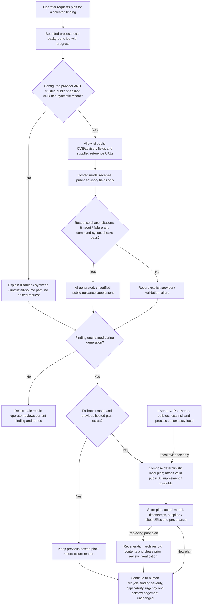

[Open SVG](diagrams/guidance.svg) · [Editable Graphviz source](diagrams/guidance.dot)

- Synthetic and imported untrusted records intentionally never call a hosted model. An official public refresh can establish eligible trusted source provenance.
- Fallback is a clearly labeled local template. Provider failure does not overwrite an existing hosted plan with fallback.
- Citation checks do not prove factual support or semantic correctness. AI cannot change findings, priority, permissions, acknowledgement or equipment.

**Implementation:** [phylax/remediation_service.py](../../phylax/remediation_service.py), [phylax/ai.py](../../phylax/ai.py), [phylax/remediation.py](../../phylax/remediation.py), [phylax/jobs.py](../../phylax/jobs.py).

## Complete remediation lifecycle

Every allowed manual status transition from the current transition map.

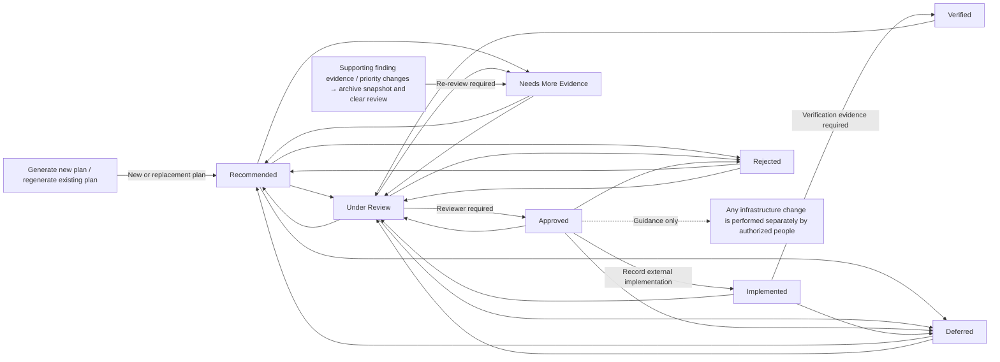

[Open SVG](diagrams/lifecycle.svg) · [Editable Graphviz source](diagrams/lifecycle.dot)

- Recommended must enter Under Review before approval. Approval requires a reviewer; Verified requires explicit verification evidence.
- Regeneration archives prior contents and returns to Recommended. Supporting finding changes archive evidence and set Needs More Evidence; obsolete findings archive plans before removal.
- Plan states do not automatically mark a vulnerability fixed or modify equipment. Update real inventory/evidence and reassess separately. Invalid transitions are rejected with retained draft input.

**Implementation:** [phylax/remediation_lifecycle.py](../../phylax/remediation_lifecycle.py), [phylax/core.py](../../phylax/core.py), [phylax/correlation.py](../../phylax/correlation.py).

## Reporting, offline operation and recovery

Understand what persists and how each interruption recovers.

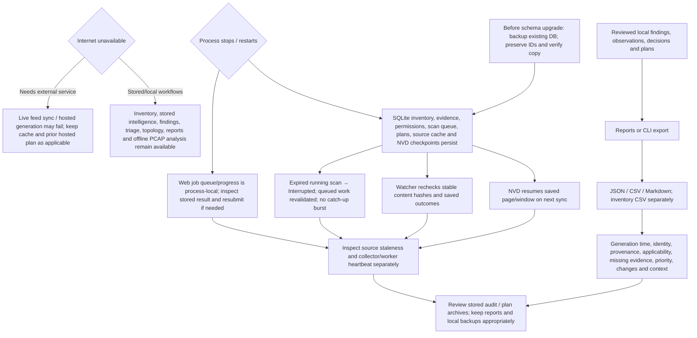

[Open SVG](diagrams/operations.svg) · [Editable Graphviz source](diagrams/operations.dot)

- Stale intelligence is visible after the stored 24-hour source-health threshold; losing internet does not immediately make a recent cache stale.
- Reports preserve uncertainty. Acknowledgement and plan verification are not proof of compromise or automatic remediation.
- No public raw-PCAP download endpoint exists. There is no immutable forensic audit system, multi-user identity provider or production military deployment claim.

**Implementation:** [phylax/reports.py](../../phylax/reports.py), [phylax/migrations.py](../../phylax/migrations.py), [phylax/jobs.py](../../phylax/jobs.py), [phylax/watcher.py](../../phylax/watcher.py), [phylax/discovery.py](../../phylax/discovery.py).

## Complete controlled demonstration

A practical route through all feature groups in a fictional isolated support-site lab.

```mermaid
flowchart TD
    n_prepare["Prepare clearly labeled fictional lab and disposable database"]
    n_inventory["Import / validate inventory; include known and incomplete identities"]
    n_context["Add owners, criticality rationale and confirmed process support"]
    n_subnet["Configure monitored subnet, management decisions and passive policy"]
    n_passive["Replay benign / write captures or import all four Zeek log kinds"]
    n_changes["Review unmanaged peer, DHCP association and service/version changes"]
    n_scan["Explicitly permit isolated supporting IT host; queue / schedule bounded discovery"]
    n_software["Review unverified software; apply exact mapping; confirm evidence"]
    n_intel["Load deterministic advisory cases plus verified public snapshot for hosted demo"]
    n_matches["Review confirmed / potential / excluded / needs-review evidence"]
    n_rules["Demonstrate writer, unexpected communication and maintenance violations"]
    n_map["Inspect topology, original events, process context and missing visibility"]
    n_triage["Compare urgency factors and acknowledge reviewed alerts"]
    n_guidance["Request eligible public guidance; exercise local fallback / provider failure honestly"]
    n_plan["Review plan; record approved, externally implemented and verified test evidence"]
    n_report["Export reports and compare evidence/counts"]
    n_offline["Disconnect; reopen stored views, offline replay and saved guidance; show health times"]
    n_prepare --> n_inventory
    n_inventory --> n_context
    n_context --> n_subnet
    n_subnet --> n_passive
    n_passive --> n_changes
    n_changes --> n_scan
    n_scan --> n_software
    n_software --> n_intel
    n_intel --> n_matches
    n_matches --> n_rules
    n_rules --> n_map
    n_map --> n_triage
    n_triage --> n_guidance
    n_guidance --> n_plan
    n_plan --> n_report
    n_report --> n_offline
```

[Open SVG](diagrams/demo.svg) · [Editable Graphviz source](diagrams/demo.dot)

- This is a demonstration itinerary, not a requirement to approve all test endpoints or scan OT. The isolated demo starts with active scanning disabled.
- Synthetic advisory cases are useful for deterministic applicability but never sent to a hosted model. Use a separately refreshed eligible public advisory to demonstrate hosted guidance.
- Use saved guidance with its original provenance when offline. Neither provider availability nor a newly published CVE should determine whether the demonstration succeeds.

**Implementation:** [scripts/prepare_release_demo.py](../../scripts/prepare_release_demo.py), [docs/manual-testing.md](../../docs/manual-testing.md), [demo/README.md](../../demo/README.md).
